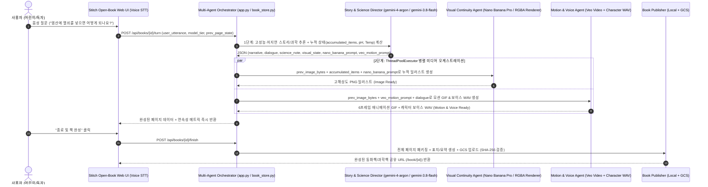

# [Hackathon PRD] WonderBook Live (원더북 라이브)
> **실시간 음성 질문("만약 ~하면 어때요?")에 맞춰 스토리·일관된 일러스트(Nano Banana)·반응 영상 및 목소리(Veo)가 이어지고, 종료 시 한 권의 책으로 저장·공유되는 인터랙티브 동화책 & 과학실험책**

---

## 1. 제품 개요 (Product Overview)

### 1.1 핵심 문제 정의
- **기존 동화책/과학책의 한계**: 아이들은 책을 읽으며 끊임없이 *"만약 토끼가 그 문을 안 열고 열쇠를 던지면 어떻게 돼요?"*, *"염산에 사과를 넣으면 어떻게 되나요? 열쇠를 넣으면요? 과자를 넣으면요?"* 같은 호기심 어린 질문을 던지지만, 정적인 책은 이에 답하거나 다음 장면을 보여줄 수 없습니다.
- **위험하거나 해볼 수 없는 실험의 한계**: 강산(염산) 반응, 우주 환경, 극한 화학 실험 등은 아이들이 실제로 해볼 수 없으며, 단순 텍스트 답변만으로는 직관적인 인과관계를 이해하기 어렵습니다.
- **멀티모달 생성 지연(Latency)과 일관성(Continuity) 문제**: 이미지와 영상 생성은 수 초~수십 초가 걸리므로, 아이가 말한 직후 빈 화면을 오래 기다리게 하면 몰입이 깨집니다. 또한 매 페이지마다 캐릭터나 실험 비커의 모양이 달라지면 한 권의 책으로 느껴지지 않습니다.

### 1.2 핵심 솔루션 (Core Solution)
**WonderBook Live**는 아이(사용자)의 순간적인 음성 발화에 맞춰 **2단계 병렬 오케스트레이션(Two-Speed Parallel Orchestration)**으로 동작하는 살아있는 그림책/과학책 플랫폼입니다.

1. **고성능·초저지연 스토리/과학 원리 전개 (Upgraded Story & Science Director — `gemini-4-argon` & `gemini-3.8-flash`)**:
   - 기존 `2.5-flash-lite` 대신 상위 모델인 **`gemini-4-argon` (`thinking_level="low"` / `"medium"`)**과 **`gemini-3.8-flash`** 멀티 티어 오케스트레이션을 적용하여, 아이의 음성 질문("염산에 열쇠를 넣으면 어떻게 돼요?", "사과도 넣으면요?")에 대해 훨씬 더 정교한 화학 반응식($\text{Fe} + 2\text{HCl} \rightarrow \text{FeCl}_2 + \text{H}_2\uparrow$), 누적 실험 맥락, 생동감 있는 동화 서사를 빠르게 구성합니다.
2. **누적 시각 맥락 및 연속성 일러스트 생성 (Cumulative Nano Banana Continuity — `gemini-3-pro-image-preview` & `gemini-2.5-flash-image`)**:
   - 직전 페이지의 이미지 바이트(`prev_image_bytes`)와 **누적 상태 벡터(`accumulated_items`, `ph_level`, `temperature_c`, `character_bible`)**를 Nano Banana Pro(`gemini-3-pro-image-preview`) / Nano Banana(`gemini-2.5-flash-image`) 및 고해상도 다층 RGBA 일러스트 엔진에 함께 전달합니다.
   - 이를 통해 2페이지에서 넣은 **금속 열쇠**, 3페이지에서 넣은 **사과**, 4페이지에서 넣은 **초코칩 과자**, 5페이지에서 뿌린 **물줄기**가 한 비커 안에 **누적되어 함께 보이는 시각적 연속성**을 구현합니다.
3. **병렬 미디어 생성 오케스트레이션 (Parallel Media Execution — `ThreadPoolExecutor`)**:
   - 페이지 전환 속도를 극대화하기 위해 **Nano Banana 고해상도 일러스트 생성**과 **Veo 모션 비디오 + 캐릭터 보이스 합성**을 순차 실행이 아닌 `ThreadPoolExecutor(max_workers=2)` **병렬 파이프라인**으로 동시에 실행합니다.
4. **Google Stitch 기반 인터랙티브 오픈북 & 실험실 웹 디자인 (`static/index.html` & `STITCH_DESIGN_GUIDE.md`)**:
   - Google Stitch 디자인 시스템을 적용하여 양면 오픈북 스프레드(Open-Book Spread), 모드별 적응형 테마(Bioluminescent Science Lab vs. Enchanted Storybook), 실시간 pH/온도/누적 아이템 배지, 하단 시각적 연속성 필름스트립 타임라인, 원클릭 완본 발행 모달을 제공합니다.

---

## 2. 두 가지 핵심 모드 (Dual Interactive Modes)

| 구분 | 모드 A: 인터랙티브 동화책 (`Storybook Mode`) | 모드 B: 인터랙티브 과학실험책 (`Science Lab Mode`) |
| :--- | :--- | :--- |
| **컨셉** | 아이의 상상에 따라 자유롭게 변주·누적되는 동화 이야기 | 실제로는 위험해서 해볼 수 없는 "만약 ~을 넣으면?" 가상 과학 실험 |
| **사용자 음성 예시** | - *"문이 열리고 아기 용이 비눗방울을 뿜으면 어때요?"* - *"무지개 구름 우주선을 타고 날아가면 어때요?"* - *"하늘에서 별사탕 비가 내리면 어때요?"* | - *"이 염산(HCl) 비커에 **열쇠(금속)**를 넣으면 어떻게 되나요?"* - *"여기에 **사과**를 넣으면 어떻게 되나요?"* - *"여기에 **과자**를 넣으면?" / "**물**을 뿌리면 어떻게 되나요?"* |
| **Nano Banana 역할** | 이전 페이지 주인공 루미(여우)의 외형·머플러·배경을 유지한 채 아기 용, 무지개 비행선, 별사탕 등 이전 턴의 요소들을 누적 합성 | 동일한 붕규산 유리 비커와 실험실 구도, 실시간 pH/온도 계기판을 유지한 채 앞서 넣은 아이템(열쇠+사과+과자+물)과 화학 반응(수소 기포, 거품, 부식)을 누적 렌더링 |
| **Veo & Voice 역할** | 캐릭터가 대사를 말하며 움직이는 애니메이션 장면 생성 | 아이템이 비커에 풍덩 들어가며 기포가 올라오거나 반응이 일어나는 실험 영상 및 친절한 과학 선생님/캐릭터 보이스 생성 |
| **완성본 형태** | 세상에 하나뿐인 나만의 동화책 (질문 스탬프 포함) | 내가 직접 실험한 '무엇이든 넣어보는 과학 실험 도감' |

---

## 3. 멀티에이전트 병렬 오케스트레이션 아키텍처 (Orchestration Architecture)

---

## 4. 모듈별 구현 및 해커톤 지침 준수 (`goo.gle/hackathon-account`)

| 파일명 | 역할 및 책임 |
| :--- | :--- |
| `config.py` | 상위 모델 ID(`PRIMARY_MODEL="gemini-4-argon"`, `FAST_STORY_MODEL="gemini-3.8-flash"`, `NANO_BANANA_PRO_MODEL="gemini-3-pro-image-preview"`, `NANO_BANANA_MODEL="gemini-2.5-flash-image"`, `VEO_MODEL="veo-2.0-generate-001"`), 누적 실험 상태 프리셋, `INFO` 레벨 로거 중앙 관리 |
| `story_agent.py` | 음성 인식 텍스트와 직전 페이지의 누적 상태(`accumulated_items`, `ph_level`, `temperature_c`)를 받아 다음 페이지 스토리/과학 원리, 캐릭터 대사, 시각 연속성 프롬프트를 생성 (`503` Retry & Fallback 내장) |
| `media_agent.py` | Nano Banana Pro/Flash 이미지 체이닝 및 다층 RGBA 고해상도(1000×640) 일러스트·모션·보이스 합성 엔진 (모든 누적 실험 아이템과 실시간 pH/온도 HUD, 이전 페이지 PIP 연속성 앵커를 함께 렌더링) |
| `book_store.py` | `ThreadPoolExecutor` 기반 병렬 미디어 생성 오케스트레이션, 페이지 히스토리 체이닝, 완본 동화책/과학책 HTML 패키징, 로컬 및 GCS(`gs://$ARTIFACT_BUCKET/books/`) 저장·검증 |
| `app.py` | Cloud Run 호환 HTTP 서버 (`0.0.0.0:$PORT`, `/healthz`, `/api/books`, `/api/books/<id>/turn`, `/api/books/<id>/finish`, `/book/<id>` 공유 뷰어) |
| `static/index.html` | Google Stitch 디자인 시스템 기반 오픈북 스프레드 웹 UI (적응형 테마, 누적 아이템 배지, 모델 티어 선택기, 음성 인식 독, 연속성 필름스트립 타임라인) |
| `STITCH_DESIGN_GUIDE.md` | Google Stitch 컴포넌트 구조, 디자인 토큰, 레이아웃 그리드 및 Stitch 프롬프트 명세서 |
| `Design.md` | 전체 시스템 설계 및 아키텍처 문서 |
