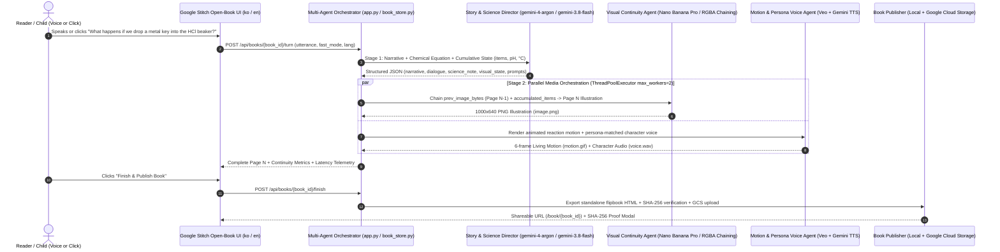

# WonderBook Live 🦉🧪🦊🚀
> **Interactive Voice-Driven Living Storybook & Safe "What-If" Science Experiment Lab**  
> Built for the **Google DeepMind AI Hackathon** (`Gemini 4 Argon in Entertainment` & `Google AI for Social Good`)

[](https://www.python.org/)
[](https://ai.google.dev/)
[](https://wonderbook-live-fdahhc3fsa-uc.a.run.app)
[](./STITCH_DESIGN_GUIDE.md)

🌐 **Live Google Cloud Run Deployment**: **[https://wonderbook-live-fdahhc3fsa-uc.a.run.app](https://wonderbook-live-fdahhc3fsa-uc.a.run.app)**

---

## 1. Overview & Motivation

When children read picture books or science books, they constantly ask spontaneous **"What-If"** questions:
- *"What happens if I drop a metal key into hydrochloric acid (`1.0M HCl`)? What if I also drop an apple, a cookie, or spray water into the same beaker?"*
- *"What happens if the baby dragon blows rainbow soap bubbles instead of breathing fire?"*
- *"What happens if we squeeze honey and orange juice in a zero-gravity space kitchen?"*

Static books cannot respond to divergent curiosity, and real-world chemical reactions (such as strong acids or zero-gravity fluid physics) are too dangerous or impossible for children to try at home. Meanwhile, conventional AI tools break immersion in two ways:
1. **Multimodal Generation Latency**: Waiting 15–30 seconds on a blank screen for sequential image/video generation loses a child's attention immediately.
2. **Broken Visual Continuity**: Standard image generators redraw a completely different beaker or character on every turn, making the experience feel like disconnected slides rather than a continuous book.

**WonderBook Live** solves both challenges through a **Two-Speed Parallel Multi-Agent Architecture** built on the `google-genai` SDK and designed with **Google Stitch**:
- **Tier 1 — Story & Science Director (`gemini-4-argon` & `gemini-3.8-flash`)**: Interprets spoken or clicked *"What-If"* questions, tracks cumulative scene state (`accumulated_items`, `ph_level`, `temperature_c`), writes child-friendly narrative and character dialogue, and generates accurate chemical reaction equations and safety insights.
- **Tier 2 — Cumulative Visual Continuity Engine (`gemini-3-pro-image-preview` / `gemini-2.5-flash-image` + Multi-Layer RGBA Continuity Engine)**: Chains `prev_image_bytes` from Page $N-1$ into Page $N$ alongside the cumulative state vector so every item dropped on previous pages (`🔑 Metal Key` + `🍎 Apple` + `🍪 Cookie` + `💧 Water Spray`) remains visibly accumulated inside the exact same beaker or storybook scene.
- **Tier 3 — Living Motion & Character Persona Voice (`Veo` + `Gemini TTS` / Web Speech API)**: Generates animated reaction clips (`motion.gif`) and persona-matched character voice audio (`voice.wav` for **Dr. Nova** `owl_professor`, **Lumi** `baby_fox`, and **Captain Orbit** `space_captain`) in parallel via `ThreadPoolExecutor(max_workers=2)`.
- **Tier 4 — Verified Book Publisher (Local + Google Cloud Storage)**: Compiles the entire multi-turn session into a standalone, shareable HTML flipbook (`/book/<book_id>` and `/api/books/<book_id>/export.html`) verified with SHA-256 digests and synced to a private Google Cloud Storage bucket (`gs://$ARTIFACT_BUCKET/books/<book_id>/`).

---

## 2. System Architecture & Multi-Agent Orchestration



### Model Roles & Failover Design (`goo.gle/hackathon-account` Compliant)

| Agent / Component | Primary Model | Companion / Fallback Model | Key Implementation Details |
| :--- | :--- | :--- | :--- |
| **Story & Science Director** | `gemini-4-argon` (`thinking_level="low"` or `"medium"`) | `gemini-3.8-flash` | Uses `google-genai` SDK (`ThinkingConfig`). Automatically retries with exponential backoff on HTTP `503` and fails over across models without using deprecated parameters (`temperature`, `top_p`, `top_k`, `thinking_budget`). Also powers the **Custom Topic Book Creator** (`POST /api/books`). |
| **Visual & Scene Engine** | `gemini-3-pro-image-preview` (Nano Banana Pro) | `gemini-2.5-flash-image` + Multi-Layer RGBA Scene Engine | Dynamically renders scene-specific illustrations per chapter in **Storybook Mode** (e.g., Tiger & Rabbit on the mountain pass, river pebble trick, persimmon tree) and high-clarity laboratory beaker states with live `pH` and `°C` HUD indicators in **Science Lab Mode**. |
| **Context-Aware Motion Engine** | `veo-3.1-fast-generate-preview` / `veo-2.0-generate-001` | 10-Frame Context-Aware Motion Synthesizer | Adapts to each book mode: in **Science Lab Mode**, renders a 3-stage chemical reaction arc (**Stage 1** reagent drop $\rightarrow$ **Stage 2** submersion & bubble nucleation $\rightarrow$ **Stage 3** vigorous effervescence & foam crown); in **Storybook Mode**, renders scene-specific living storybook motion tailored to each chapter's narrative action. |
| **Character Persona Voice** | `gemini-2.5-flash-preview-tts` / `gemini-2.5-pro-preview-tts` | Distinct Persona Acoustic DSP + Browser `speechSynthesis` | Matches distinct character voices (`owl_professor` warm baritone, `baby_fox` bright child-like tone, `space_captain` crisp mission-control voice) in parallel (`0.5–3.9s` non-blocking turn latency). |

---

## 3. Dual Interactive Modes, Custom Topic Creator & Pure Localization (`en` / `ko`)

WonderBook Live supports instant 1-click switching between **100% Pure English (`🌐 English`)** and **100% Pure Korean (`🌐 한국어`)**, a **Non-Blocking Parallel UI** (allowing readers to flip through pages or switch books while a new turn renders in the background), and a **✨ Custom Topic Book Creator** where users can type any story or science topic to start a brand-new book immediately. Crucially, the engine separates **Science Lab Mode** and **Fairy-Tale Storybook Mode** so each behaves naturally:

1. **🧪 Dr. Nova's What-If HCl Lab (`science_hcl_lab` — Independent Science Lab Mode)**
   - **Protagonist**: Dr. Nova the Clockwork Owl (`owl_professor`)
   - **Independent Single-Reagent Experiments**: Test each reagent cleanly on its own—drop a **Metal Key** ($\text{Fe(s)} + 2\text{HCl(aq)} \rightarrow \text{FeCl}_2\text{(aq)} + \text{H}_2\text{(g)}\uparrow$), an **Apple Slice** (acid-pectin maceration), a **Chocolate-Chip Cookie** (carbonate neutralization, splash & creamy $\text{CO}_2$ foam crown), **Baking Soda**, or **Water Spray** (exothermic acid dilution safety warning) into a $500\text{ mL}$ borosilicate beaker of $1.0\text{ M HCl}$.
   - **3-Stage Chemical Process Motion**: Exclusively in Science Lab mode, each experiment visualizes the 3-stage physical/chemical progression (**Drop & Trajectory** $\rightarrow$ **Submersion & Bubble Nucleation** $\rightarrow$ **Vigorous Effervescence & Foam Crown**) alongside live `pH` and `Temperature (°C)` readouts.
2. **🦊 Lumi the Starlight Fox & the Whispering Door (`fairy_starlight_fox` — Cumulative Storybook Mode)**
   - **Protagonist**: Lumi the Starlight Fox (`baby_fox`)
   - **Chapter-by-Chapter Story & Scene Generation**: Summon a bubble-blowing baby dragon, board a rainbow cloud airship, or call down a star-candy meteor shower—each page turn builds the cumulative story and generates a brand-new chapter illustration and scene-tailored motion without any laboratory UI clutter.
3. **🐯🐰 Tiger & Rabbit Folktale (`fairy_tiger_rabbit` / Custom Topic Creator — Cumulative Storybook Mode)**
   - **Protagonist**: Clever Mountain Rabbit & Hungry Tiger (`baby_fox` / folktale persona)
   - **Chapter-Matched Scenes & Motion**: Progress through the traditional folktale chapters (offering a warm rice cake on the mountain pass, roasting river pebbles by the stream, or luring the tiger to the persimmon tree) with each page generating a matching scene illustration and tailored storybook animation.
4. **🚀 Captain Orbit's Zero-G Space Shuttle Lab (`science_space_kitchen` — Science Lab Mode)**
   - **Protagonist**: Captain Orbit (`space_captain`)
   - **Experiments**: Squeeze golden honey spheres, launch fizzy orange juice bubbles, or toast marshmallows in microgravity to observe surface tension ($F_\gamma = \gamma L$) and momentum conservation.

---

## 4. Repository Structure

```text
.
├── app.py                    # Cloud Run compatible HTTP server & REST API entrypoint
├── config.py                 # Centralized model IDs, localized presets (ko/en), and INFO audit logger
├── story_agent.py            # Gemini 4 Argon / 3.8 Flash story & science director with 503 failover
├── media_agent.py            # Nano Banana Pro/Flash visual continuity, Veo motion, and persona TTS engine
├── book_store.py             # ThreadPoolExecutor parallel orchestrator, flipbook exporter, and GCS publisher
├── static/
│   └── index.html            # Google Stitch dual-theme open-book web application
├── tests/                    # Automated unit, API, localization, continuity, and e2e smoke tests
├── STITCH_DESIGN_GUIDE.md    # Google Stitch component hierarchy, color tokens, and UI prompts
├── Design.md                 # System architecture and module specification
├── PRD.md                    # Product Requirements Document
├── Dockerfile                # Production container definition for Google Cloud Run
├── requirements.txt          # Python dependencies (google-genai, pillow, google-cloud-storage, pytest)
└── .env.example              # Safe environment variable template (no secrets)
```

---

## 5. Installation & Local Quickstart

### Prerequisites
- **Python 3.11+**
- A **Google AI / Gemini API Key** (`GEMINI_API_KEY`) with access to `gemini-4-argon` and companion models
- *(Optional)* **Google Cloud SDK (`gcloud`)** authenticated with a GCP project and private Cloud Storage bucket for cloud publishing

### Step 1 — Clone & Install Dependencies
```bash
git clone https://github.com/Love-Ash/wonderbook-live.git
cd wonderbook-live
pip install -r requirements.txt
```

### Step 2 — Configure Environment Variables
Copy `.env.example` to `.env` and set your `GEMINI_API_KEY`:
```bash
cp .env.example .env
```
Or export directly in your shell:
```powershell
# PowerShell
$env:GEMINI_API_KEY="your_gemini_api_key"
$env:GOOGLE_CLOUD_PROJECT="your-gcp-project-id"
$env:ARTIFACT_BUCKET="your-private-gcs-bucket"
```

### Step 3 — Run the Server
```bash
python app.py
```
Open **`http://127.0.0.1:8080`** in Chrome or Edge.
- Click **`🌐 English`** (or **`🌐 한국어`**) in the top bar to switch the entire interface and book presets to pure English or pure Korean.
- Click any **1-Click "What-If" Curiosity Chip** or press the **Push-to-Talk Microphone (`🎤`)** to ask your own question and turn the page.
- Click **`📚 Finish & Publish Book`** to compile a standalone shareable HTML flipbook and verify its SHA-256 digest.

### Step 4 — Run Automated Tests
```bash
pytest -q
```

---

## 6. Deploying to Google Cloud Run

WonderBook Live is container-ready (`Dockerfile` + `.gcloudignore`) and listens on `0.0.0.0:$PORT` with a dedicated `/healthz` endpoint.

```bash
gcloud run deploy wonderbook-live \
  --source . \
  --project "$GOOGLE_CLOUD_PROJECT" \
  --region us-central1 \
  --service-account "$RUN_SERVICE_ACCOUNT" \
  --set-env-vars "GOOGLE_CLOUD_PROJECT=$GOOGLE_CLOUD_PROJECT,ARTIFACT_BUCKET=$ARTIFACT_BUCKET" \
  --allow-unauthenticated
```

---

## 7. REST API Reference

| Method & Path | Description |
| :--- | :--- |
| `GET /healthz` | Health check endpoint returning `200 OK` (`{"status": "ok"}`). |
| `GET /api/system-status?lang=en` | Returns active multi-agent model IDs, localized presets (`en` or `ko`), and Cloud Storage configuration status. |
| `POST /api/books` | Creates a new interactive book session (`preset_id`, `lang`, `custom_title`) and generates Page 1 seed media. |
| `GET /api/books/<book_id>` | Retrieves full book metadata, cumulative visual state, and all generated pages. |
| `POST /api/books/<book_id>/turn` | Runs the parallel multi-agent pipeline for a spoken/typed `user_utterance` (`fast_mode`: `argon_low`, `flash_ultra`, or `argon_medium`). |
| `POST /api/books/<book_id>/finish` | Compiles the standalone HTML flipbook (`export.html`), computes SHA-256 verification digests, and uploads artifacts to `gs://$ARTIFACT_BUCKET/books/<book_id>/`. |
| `GET /book/<book_id>` | Opens the standalone interactive flipbook viewer for a published book. |
| `GET /api/books/<book_id>/export.html` | Downloads the self-contained single-file HTML book with embedded media. |

---

## 8. Demo Walkthrough (Reproducible 2-Minute Flow)

1. **Launch & Switch to English (`0:00–0:20`)**:
   - Open the deployed Cloud Run URL (or `http://127.0.0.1:8080`) and switch the language toggle to **`🌐 English`**.
   - Select **`Dr. Nova's What-If HCl Lab`** (`Science Lab Mode`). Observe Page 1: a $500\text{ mL}$ beaker of $1.0\text{ M HCl}$ at $\text{pH } 1.0$ and $22.0^\circ\text{C}$.
2. **Turn 1 — Drop a Metal Key (`0:20–0:55`)**:
   - Click or speak: *"What happens if we drop a metal key into the HCl beaker?"*
   - Observe **Page 2**: `gemini-4-argon` explains single-displacement oxidation ($\text{Fe(s)} + 2\text{HCl(aq)} \rightarrow \text{FeCl}_2\text{(aq)} + \text{H}_2\text{(g)}\uparrow$), temperature rises to $26.5^\circ\text{C}$, $\text{pH}$ shifts to $1.4$, and the illustration + animated motion show the key corroding with rising hydrogen bubbles while Dr. Nova speaks.
3. **Turn 2 — Drop an Apple into the Same Beaker (`0:55–1:30`)**:
   - Click or speak: *"What if we drop an apple into this same beaker?"*
   - Observe **Page 3 Cumulative Continuity**: Both `#1 🔑 Metal Key` AND `#2 🍎 Apple` are visibly rendered together inside the same beaker (`Chained from Page 2`), with a Picture-in-Picture anchor of Page 2 in the top-right corner.
4. **Publish & Verify (`1:30–2:00`)**:
   - Click **`📚 Finish & Publish Book`**.
   - Inspect the **SHA-256 Manifest & HTML Export Digests** and **Google Cloud Storage Sync (`gs://...`)** status, then open the standalone flipbook viewer (`/book/<book_id>`).

---

## 9. Scope, Limitations & Safety Guardrails

- **Educational Simulation Scope**: WonderBook Live is an interactive educational storytelling and conceptual science visualization tool. Its chemical equations, `pH`, and temperature readouts represent pedagogical models rather than laboratory-grade physical instrumentation.
- **No Unverified Efficacy Claims**: This project has not been evaluated in formal clinical or longitudinal classroom trials; we make no claims of measured learning-outcome gains prior to formal user studies.
- **Resilient Multimodal Fallbacks**: When live preview image/video/TTS endpoints (`gemini-3-pro-image-preview`, `veo-3.1-fast-generate-preview`, `gemini-2.5-flash-preview-tts`) experience quota throttling or transient `503` errors during peak event traffic, `media_agent.py` automatically falls back to a deterministic high-resolution multi-layer RGBA continuity renderer and persona acoustic synthesizer so page turns never fail or block the reader.
- **Safety & Privacy**: All safety notes explicitly instruct learners never to handle strong acids without adult supervision and protective equipment. No API keys, credentials, or personal identifiable information (PII) are stored in source code, client HTML, or audit logs (`runtime/wonderbook_audit.log` strips binary payloads and secrets).

---

## 10. License

Released under the [MIT License](./LICENSE).
